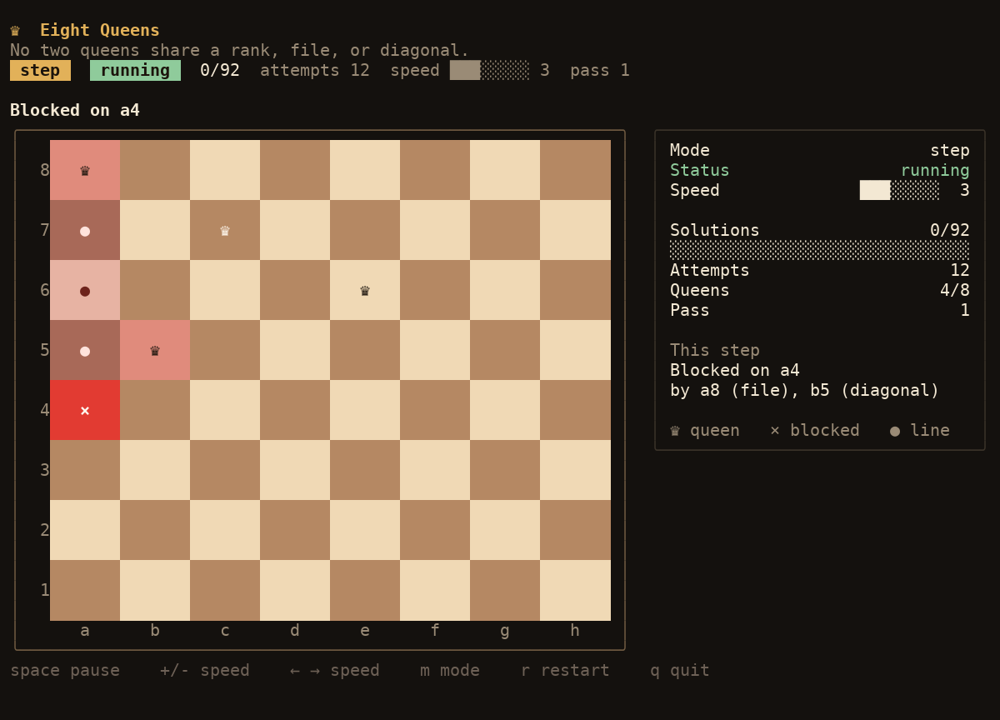
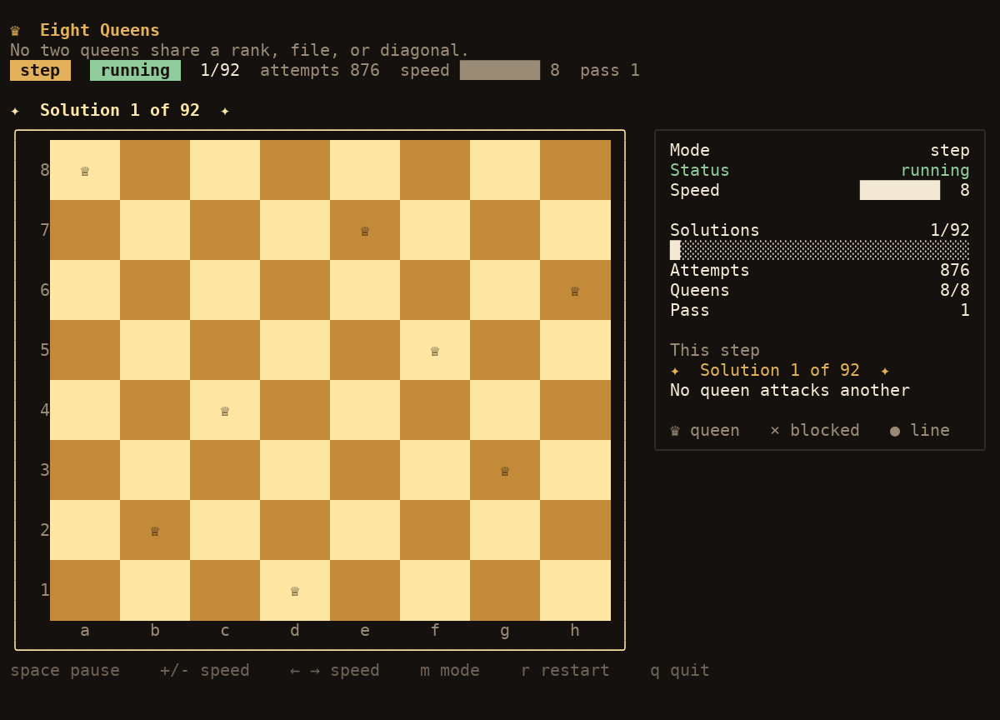
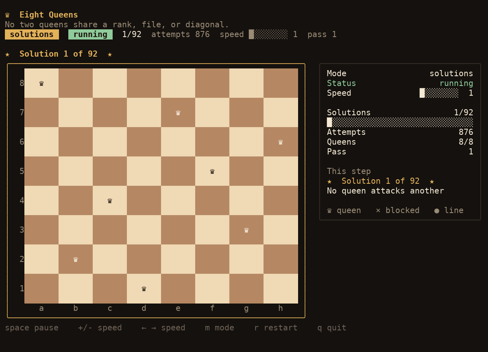

# Eight Queens

A terminal animation of the eight queens puzzle. Backtracking places one queen per rank, tries every file, and retreats when a square is attacked. The search finds all **92** solutions, draws each attempt, and then starts over.



## Run

```bash
go install github.com/Sigmus/8queens@latest
```

Or from a checkout of this repo:

```bash
go run .
go run . -mode solutions
go run . -mode step -speed 3
```

Go 1.24 or newer. To build a binary:

```bash
go build -o eightqueens .
./eightqueens
```

`-mode` is `step` or `solutions`. `-speed` is `1` (slow) through `8` (fast).

## Keys

| Key | Action |
| --- | --- |
| space | pause / resume |
| `+` / `-`, or the arrow keys | speed up / slow down |
| `1`–`8` | jump to a speed |
| `m` or tab | switch mode |
| `r` | restart the search |
| `q` or Ctrl+C | quit |

Nothing else stops the search. After solution 92 the board clears and the walk begins again. Only the spacebar pauses it.

## Modes

**Step** draws every attempt. A placed queen is marked on its square. A blocked square turns red, the queens that attack it are highlighted, and the squares between them are marked. Taking a queen back is shown too. When all eight queens are safe, the board flashes gold, then the search continues.



**Solutions** skips the attempts and shows each finished board, all 92 of them, one after another.



The board and the side panel shrink to fit the terminal. Below about 28×15 it asks you to resize instead of drawing a broken grid.

## Recording

[`docs/demo.cast`](docs/demo.cast) is an asciinema recording of step mode:

```bash
asciinema play docs/demo.cast
```

## Tests

```bash
go test ./...
```

The solver lives in `solver` and does not know about the terminal. `NewStepper` walks one event at a time (place, conflict, solution, backtrack). The Bubble Tea model pulls the next event when a frame is due. Tests check the classic solution counts for boards of size 1 through 8, and that the eight-queens trace contains exactly 92 legal, distinct solutions.
